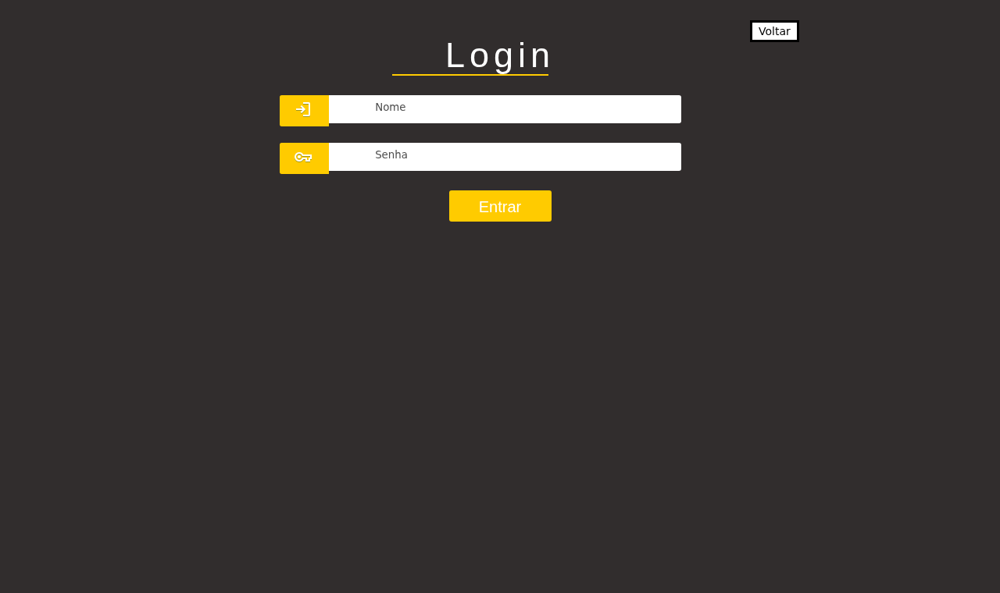
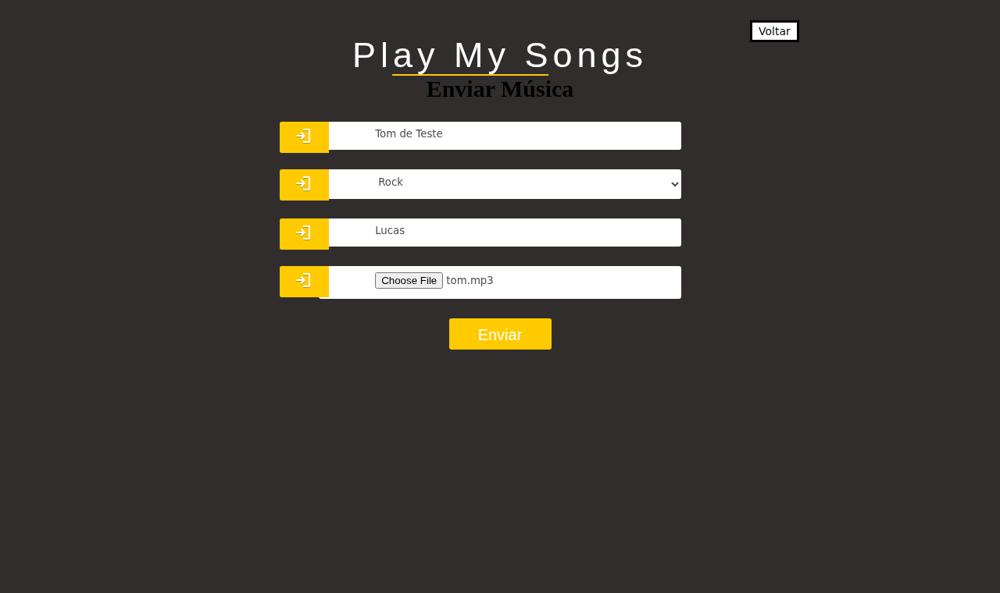
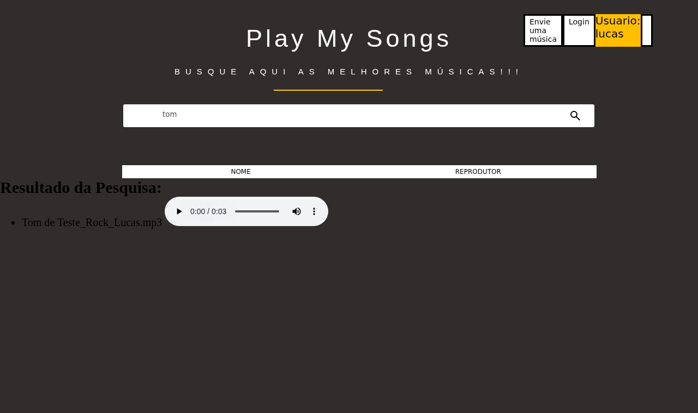

# 🎧 PlayMySongs

Aplicação web em **Java com Servlets e JSP (Jakarta EE)** para **enviar músicas, buscar pelo nome e ouvir direto no navegador**. Tem login por sessão, upload de arquivos com validação dos dados e busca assíncrona (AJAX) que monta a lista com um player de áudio HTML5.


## 📸 Screenshots

> Capturadas rodando o projeto no Tomcat 10.1, com um arquivo de áudio de teste.

| Login | Envio de música |
|---|---|
|  |  |

**Busca com player de áudio**



## ✨ Funcionalidades

- **Login e logout** com `HttpSession` (`/login-servlet` e `/logout-servlet`). Regra do exercício: a senha é o próprio login escrito ao contrário.
- A página inicial mostra o usuário logado e exibe ou esconde as opções conforme a sessão.
- **Upload de música** (`/upload`, multipart) com nome, estilo (Pop, Rock, Hip Hop, Eletrônica, Sertanejo) e artista.
  - Os campos são validados com expressão regular (letras, números, espaço e `_`).
  - O arquivo é salvo na pasta `musicas/` da aplicação como `nome_estilo_artista.extensão`.
- **Busca de músicas** (`/searchMusic`): requisição AJAX (`XMLHttpRequest`) que filtra os arquivos pelo nome e devolve a lista com um **player `<audio>`** para cada música.

## 🔌 Rotas (Servlets)

| Método | Rota | Descrição |
|---|---|---|
| POST | `/login-servlet` | Autentica e cria a sessão |
| GET | `/logout-servlet` | Encerra a sessão |
| POST | `/upload` | Envia uma música (multipart/form-data) |
| GET | `/searchMusic?searchQuery=` | Busca músicas pelo nome |

## 📁 Estrutura do projeto

```
music-library-servlets-jsp/
├── pom.xml                                   # Empacotamento WAR, Jakarta Servlet
└── src/main/
    ├── java/com/example/playmysongs/
    │   ├── loginServlet.java
    │   ├── LogoutServelet.java
    │   ├── UploadServlet.java
    │   ├── SearchMusicServlet.java
    │   └── security/User.java                # Usuário guardado na sessão
    └── webapp/
        ├── index.jsp                         # Busca e player
        ├── login.jsp
        ├── enviamusica.jsp                   # Formulário de upload
        ├── assets/css/css.css
        └── WEB-INF/web.xml
```

## ▶️ Como executar

Pré-requisitos: **JDK 11+** e um servidor compatível com **Jakarta Servlet 5/6**, como o **Apache Tomcat 10.1**.

```bash
git clone https://github.com/lukinha21/music-library-servlets-jsp.git
cd music-library-servlets-jsp
./mvnw package      # no Windows: mvnw.cmd package
```

O Maven Wrapper (`./mvnw`) baixa o Maven sozinho; não precisa instalar.

1. Copie `target/playmysongs-1.0-SNAPSHOT.war` para a pasta `webapps/` do Tomcat (por exemplo, com o nome `playmysongs.war`).
2. Inicie o Tomcat (`bin/startup.sh` ou `bin\startup.bat`).
3. Acesse **http://localhost:8080/playmysongs/**.
4. Faça login (ex.: usuário `lucas`, senha `sacul`), envie uma música e use a busca.

Também dá para rodar pelo IntelliJ IDEA, configurando um Tomcat 10 local.

## 👨‍💻 Autores

**Lucas Alexandre**, estudante de Sistemas de Informação na Unoeste

- GitHub: [@lukinha21](https://github.com/lukinha21)
- LinkedIn: [Lucas Silva](https://www.linkedin.com/in/lucas-silva-025583180)

Projeto desenvolvido com **Beatriz Araujo**.
